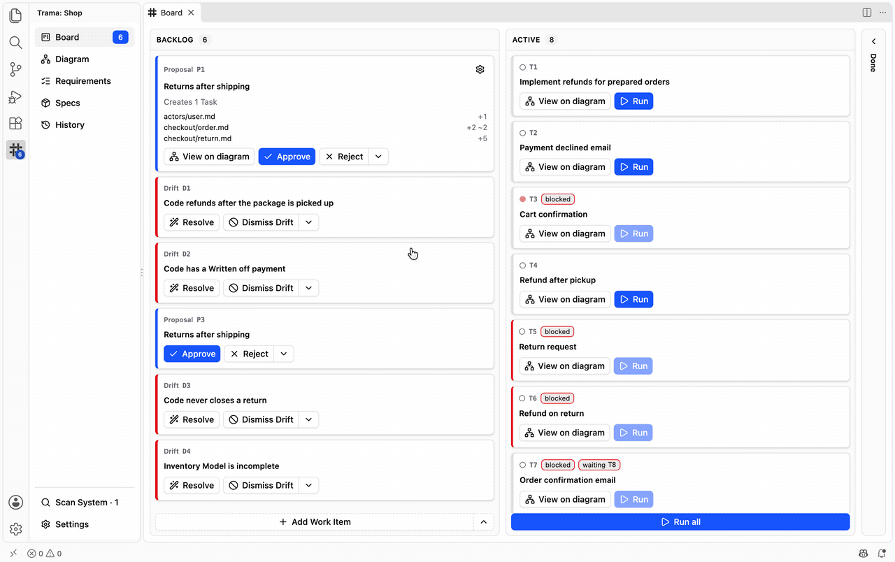
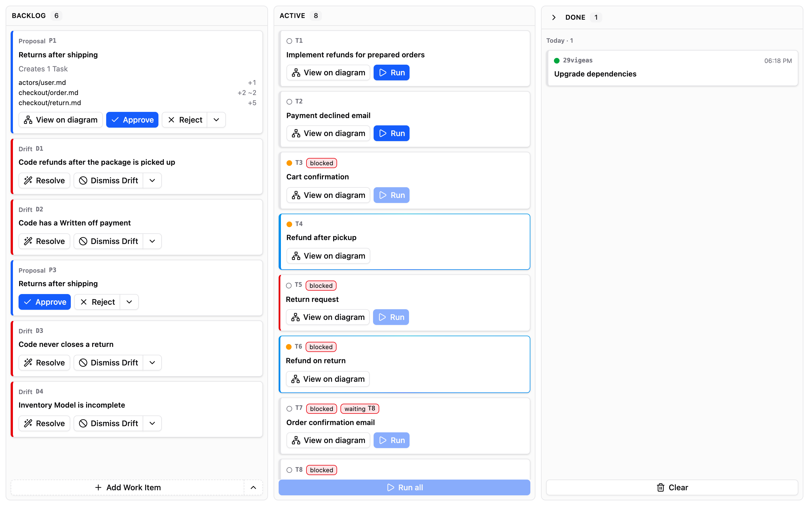
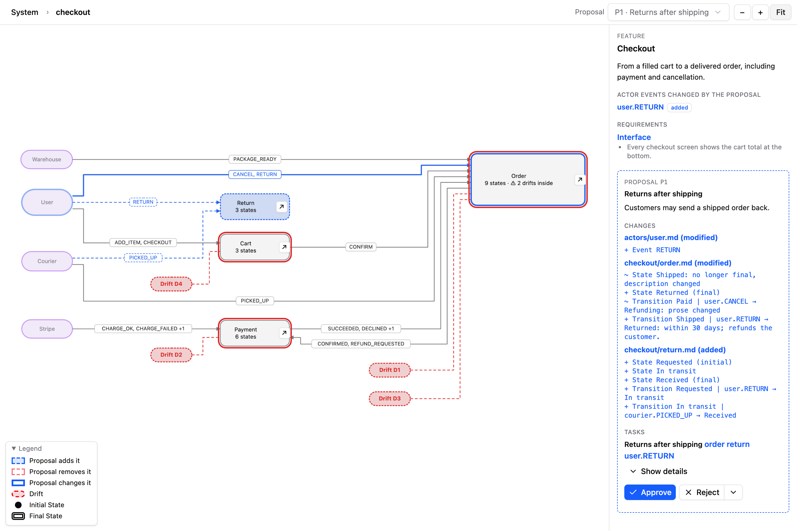
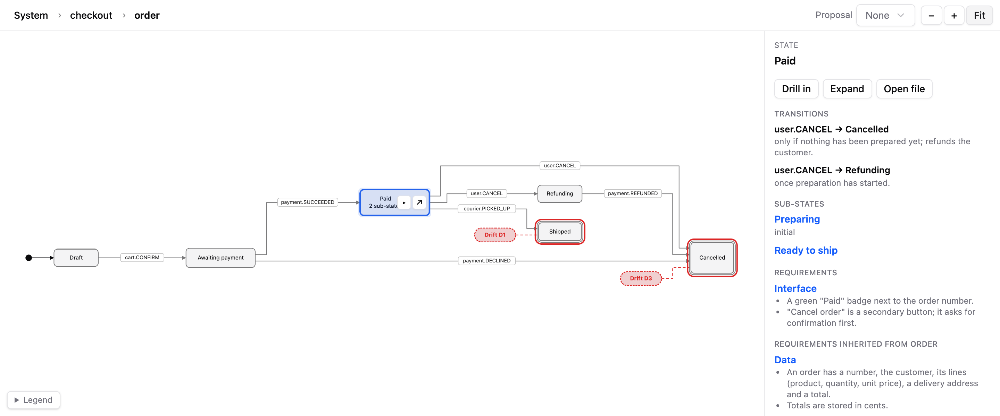
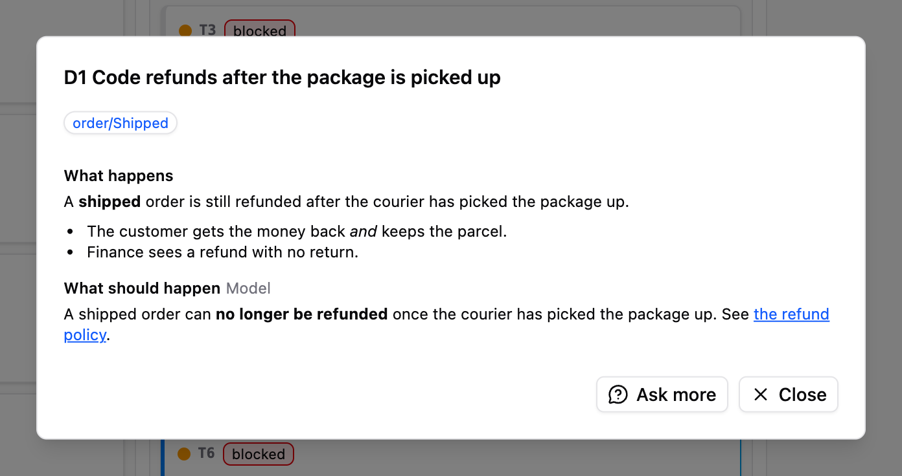

# Trama

**Your AI agent writes code fast. Trama makes sure it's the code you meant.**

> **Windows (x64) is experimental.** It is tested less than Linux and macOS, some parts may not work as described, and `trama.exe` is not signed, so SmartScreen or an antivirus may warn the first time it runs.



**[Read the guide](https://nicchia-code.github.io/trama/)**

Trama keeps a map of your app next to your code, as plain Markdown in `.trama/` drawn for you as a diagram. Your agent reads the map before it writes a line, and every change arrives as a Proposal you approve before any code exists.

## How it works

### 1. Describe a change

Say what you want in plain words, as you'd tell a colleague.



### 2. Answer the agent's questions

Only what it can't decide alone, with its recommendation already selected.


### 3. Approve the Proposal

The change drawn on the map, with every decision and assumption beside it.



### 4. Run the Tasks

The agent builds what you approved, one Task at a time or all together, while you follow along.



### 5. Resolve the Drifts

When the code and the map stop telling the same story, Trama raises a Drift. Fix the code, or keep it and update the map: you decide which one is right.



## Requirements

- VS Code 1.106 or later, the only editor Trama supports.
- Linux (x64), macOS (Apple silicon) or Windows (x64, experimental).
- omp, the only agent Trama supports.
- The GitHub CLI (`gh`), only for the PR Check and Team.

## Install

Download the `.vsix` for your platform from [Releases](https://github.com/nicchia-code/trama/releases), then run **Extensions: Install from VSIX…** from the command palette, or:

```sh
code --install-extension trama-<platform>-<version>.vsix
```

> **omp Chat runs every command without asking by default** (approval `yolo`). To have it ask first, set `trama.ompChatApproval` to `ask` in your user settings.

## Learn more

The details of the features live in the [guide on the website](https://nicchia-code.github.io/trama/guide/), with the [changelog](./CHANGELOG.md), the [command line reference](./docs/cli.md) and the description of each setting in the editor.

- [Website and guide](https://nicchia-code.github.io/trama/)
- [What the words mean](./CONTEXT.md)
- [Model file format](./docs/model-format.md)
- [Command line reference](./docs/cli.md)
- [Contributing](./CONTRIBUTING.md)

## License

Trama is open source under the [GNU AGPL v3](./LICENSE): use it, change it and share it, as long as your changes stay open too. For a commercial license, [get in touch](mailto:luca.soda@gmail.com).

Copyright © 2026 Luca Soda
