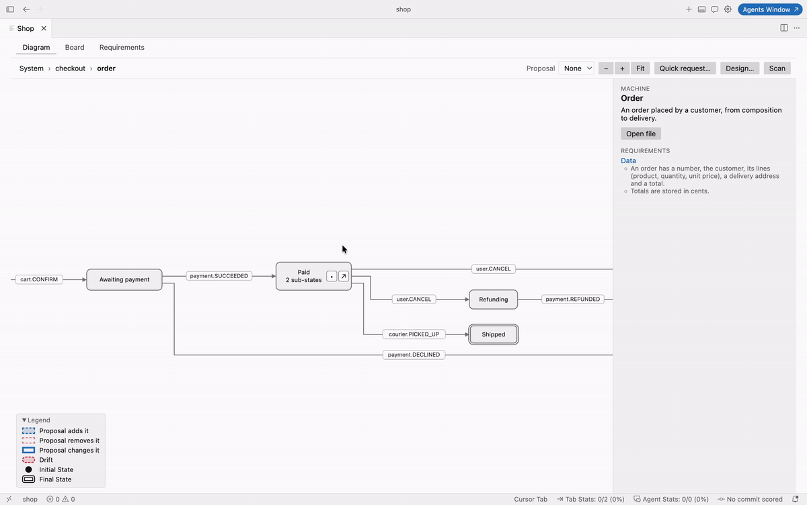
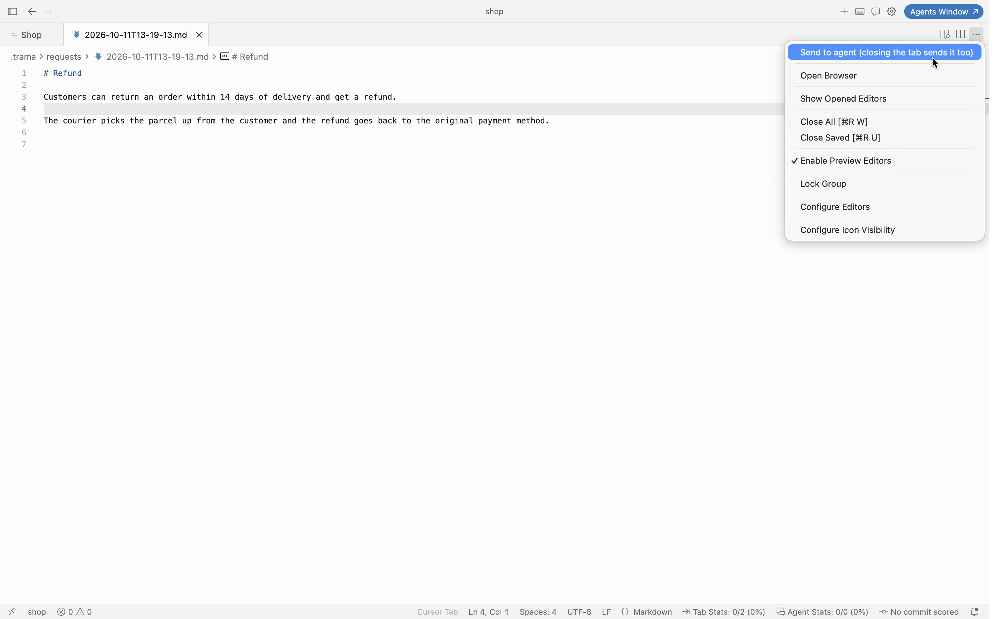
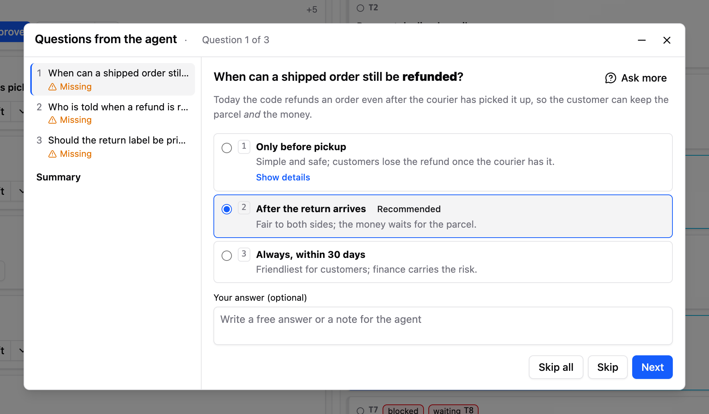
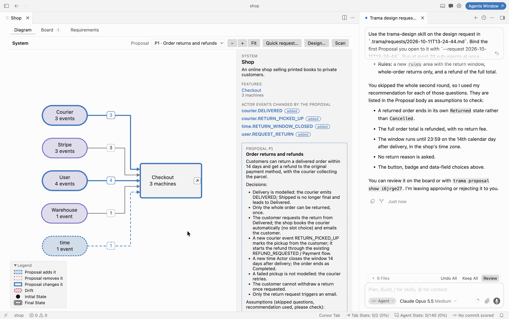
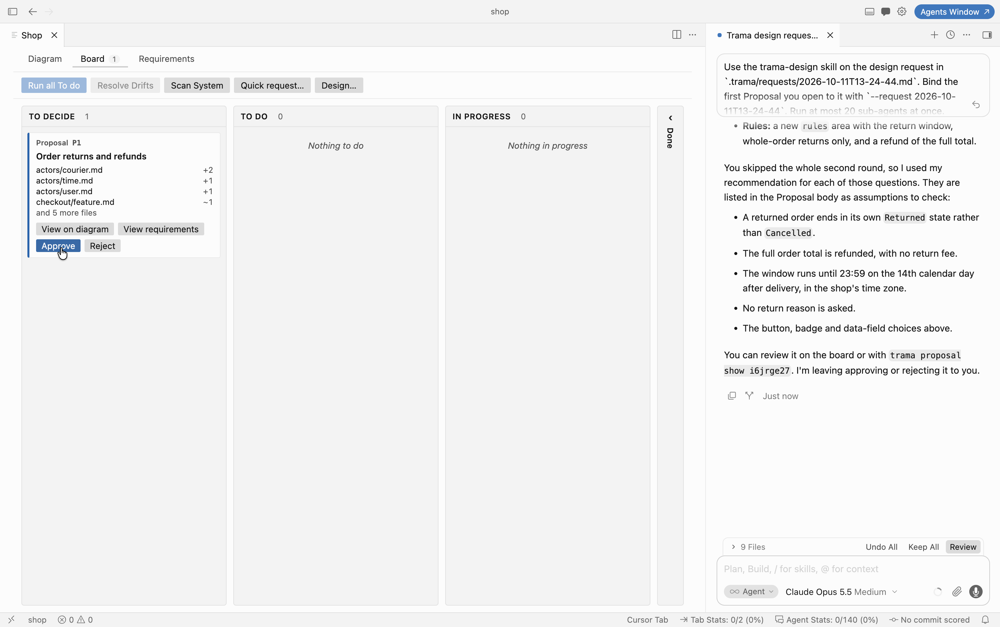
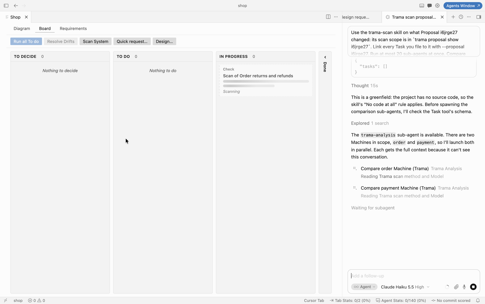
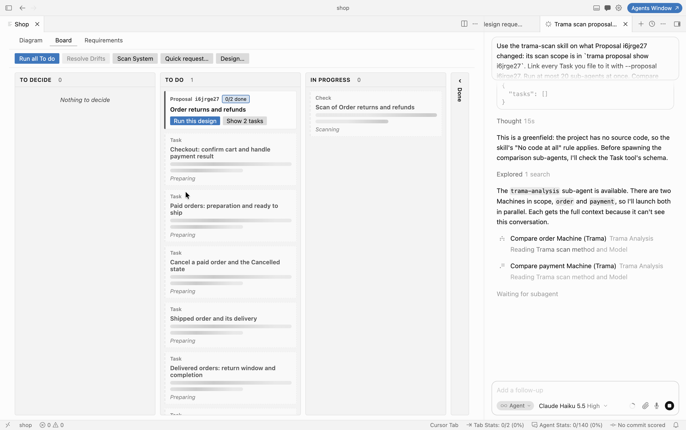
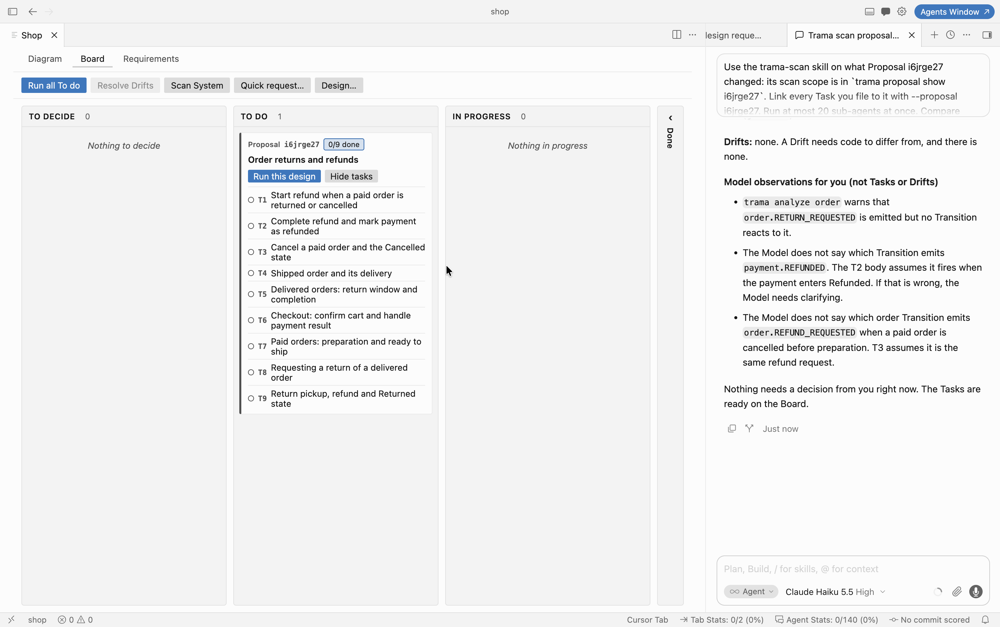
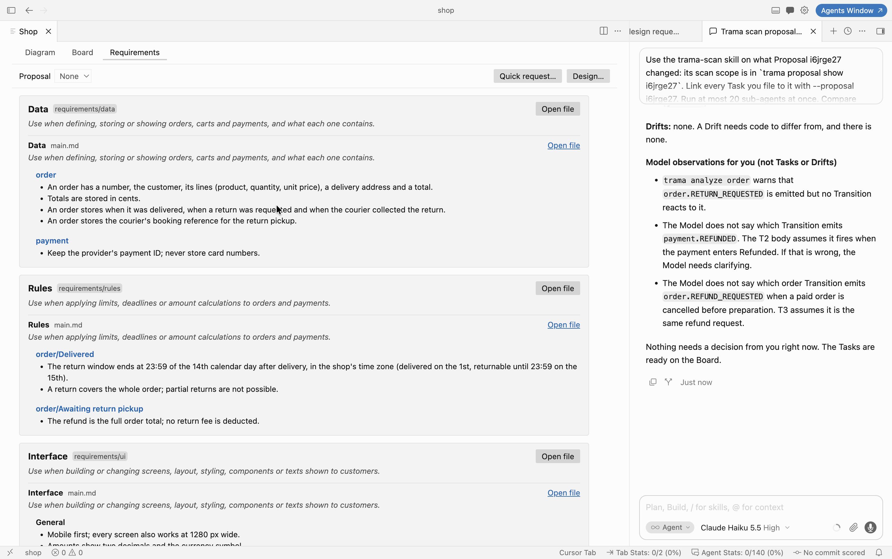
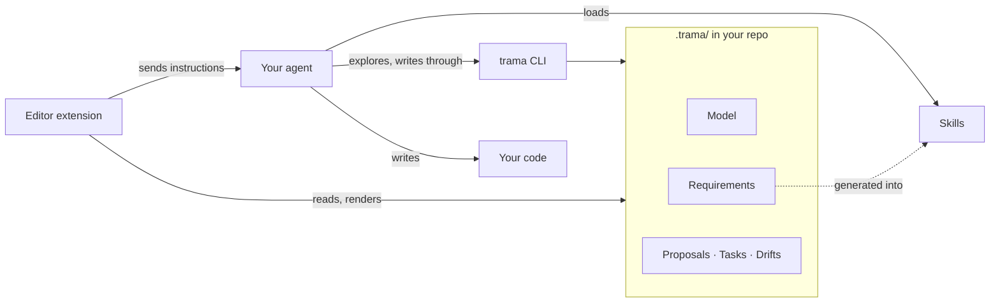

# Trama

**T**asks · **R**equirements · **A**nalysis · **M**ap · **A**gents

**Your AI agent writes code fast. Trama makes sure it's the code you meant.**



When an agent writes most of the code, it's easy to lose track of what your software actually does. Every prompt adds behaviour nobody looked at.

Trama gives you and your agent a shared **map of your app**: every situation it can be in, and what moves it from one to the next. The agent writes the map as plain text, and Trama draws the diagram from it, automatically and always up to date. You never drag a box or draw an arrow. The agent reads the map before it writes a line.

## See it in action

Let's add returns to a small online shop: the [shop example](./examples/shop) that comes with Trama.

### 1. Say what you want

Write it the way you'd tell a colleague. One line is enough, or take a whole page. Send it from the tab's menu; closing the tab sends it too.



Your agent picks it up right away, in the chat or terminal you already use, and starts reading the map.

### 2. Answer a few questions

The agent asks only what it can't decide alone. For returns it had nine questions, starting with how a delivery should be modelled, since the 14 days start from it. Each one comes with the agent's recommendation already selected, so most of the time you just confirm. Skip the ones you don't care about: the agent uses its recommendation and lists it as an assumption for you to check.



### 3. See the change before any code exists

When the agent is done, pick its Proposal on the map: new parts in blue, removed parts in red. Here, returns bring in a new Actor, time, which closes the return window. The side panel sums up every decision and every assumption.



On the board, the Proposal lists every file it touches. Approve it, or reject it with a note.



### 4. Watch it get built

The agent checks the design against the code, one sub-agent per Machine, in parallel.



Tasks appear on the board as the agent prepares them.



The returns design became nine Tasks, each tagged with the Proposal it comes from.



Click **Run all To do**, and the agent works through them while you follow along.

### 5. Know when code and map disagree

When the code does something the map doesn't say, or breaks one of your rules, Trama calls it a **Drift**.

A Drift is not a bug report. It only says that the code and the map no longer tell the same story, and it doesn't decide which one is right:

- **The code may be wrong.** The agent misread a Task, or a quick hand fix skipped a case: a bug.
- **The map may be out of date.** You changed your mind while coding, or the code handles a case nobody thought to draw: the code is right, and the map should catch up.
- **Both may be reasonable.** Two valid answers to a question the map never asked: it's a decision only you can make.

Small details that change neither the diagram nor one of your rules aren't Drifts: Trama raises one only when the behaviour itself differs.

Each Drift shows what happens, what should happen, and two to five ways to fix the code, with the agent's recommendation first. You pick one. Or you keep the code as it is, and the map is updated to match. Until you decide, the agent won't start any Task about that part of the app, so nothing new gets built on shaky ground.

### 6. Set the rules once

Tech stack, design, data, business rules: write them once, next to the map, and the agent follows them on every task.

Rules grow with the map. The returns design added its own: the window ends at 23:59 on the 14th day after delivery, a return covers the whole order, and the refund is the full total. Each rule is tied to the exact part of the map it applies to, like `order/Delivered`.



## Yes, it's slower than raw vibe coding

Trama is still vibe coding: you describe what you want, and the agent writes the code. What changes is what happens in between.

With raw vibe coding, you type a prompt and code appears. With Trama, you answer questions, look at the change on the map, approve it, and only then does the agent write code. Every feature takes more steps, and you'll feel it.

That time isn't lost. It's spent where it's cheapest:

- **Deciding before building.** A question answered now is cheaper than a feature rebuilt later. Changing a line on the map takes a second; ripping out code that went the wrong way takes an afternoon.
- **Never explaining twice.** The map and your rules stay in the repo. Every new session, every agent, every teammate starts from what's already decided, not from an empty chat.
- **Catching mistakes while they're small.** A Drift flags code that went off the map as soon as it's scanned, before more features get piled on top of it.
- **Letting agents work in parallel.** Because every Task is tied to a clear part of the map, several agents can build at once without stepping on each other.

The first feature is slower. The fiftieth isn't, because the app is still one you understand.

If you're hacking a weekend prototype you'll throw away on Monday, raw vibe coding is fine. Trama is for software you mean to keep.

## Already have a project?

Point Trama at your existing code. The agent draws the map of what your app does today, and flags anything that looks wrong along the way.

## What's in the name

*Trama* is Italian for the **weft**: the thread a weaver passes back and forth through the loom until a pattern appears. Once the cloth is woven, the pattern holds. You can't change it by tugging at a single thread: a stray pull shows at once, and a new pattern has to be woven on purpose.

That's the idea behind Trama. Your agent is a very fast weaver, and the map is the pattern. Every change to the design is woven in deliberately, as a Proposal you approve, and a thread pulled out of place in the code shows up as a Drift.

In Italian, *trama* is also the **plot** of a story: what happens, in what order, and why. A map of every state your app can be in, and every event that moves it on, is exactly that.

The letters spell out what's inside:

- **Tasks**: the work the agent picks up, on a board you can follow.
- **Requirements**: how your app must be built, written once and followed every time.
- **Analysis**: the agent compares your code with the map and tells you where they disagree.
- **Map**: every situation your app can be in, drawn for you as a diagram.
- **Agents**: works with the one you already use: Copilot Chat, Cursor, Claude Code or omp.

## Try it

Trama runs in VS Code and Cursor, on Linux (x64), macOS (Apple silicon) and Windows (x64, preview).

1. **Install the extension.** Download the `.vsix` for your platform from [Releases](https://github.com/nicchia-code/trama/releases), then run **Extensions: Install from VSIX…** from the command palette, or:
   ```sh
   code --install-extension trama-<platform>-<version>.vsix
   ```
   The `trama` command line comes inside the extension, so there's nothing else to install.
2. **Pick your agent** in Settings (`trama.agent`), *before* you initialize a project:
   - `chat` (default): Copilot Chat in VS Code, or the chat in Cursor.
   - `claude`: Claude Code in a terminal. Also set `trama.skillsDir` to `.claude/skills`, so Claude Code finds Trama's skills.
   - `omp`: omp in a terminal.

   Terminal agents must already be installed and on your `PATH`.
3. **Open your project** and run **Trama: Open**.
4. In **Get Started** (the panel shows it in any folder without a Trama project), choose **Import from Code** for an existing app, or **Start from Scratch** for an empty folder: it creates the project and opens an empty design request for your first feature, which the agent answers with the `trama-setup` skill.
5. In the Board, click **Design…** and describe your first feature (with an empty Model, the Diagram offers **Import from Code** and **Start from Scratch** too).

> **Windows is in preview.** The `win32-x64` build is not yet verified end to end on Windows 11 (VS Code and Cursor, omp and Claude Code, Windows PowerShell 5.1, PowerShell 7 and Git Bash); the manual check in [`docs/uat.md`](docs/uat.md) decides when the preview ends.
>
> **`trama.exe` is not signed.** Windows SmartScreen or an antivirus may warn the first time it runs. The command line is distributed only inside the `.vsix`, as on the other platforms.

### Settings

For Claude Code, writing in Italian, a typical setup looks like this:

```jsonc
// settings.json
{
  "trama.agent": "claude",
  "trama.skillsDir": ".claude/skills",
  "trama.language": "Italian"
}
```

| Setting | Default | What it does |
|---|---|---|
| `trama.agent` | `chat` | Where Trama sends its instructions: `chat`, `claude` or `omp`. |
| `trama.skillsDir` | `.agents/skills` | Where Get Started installs the agent skills. Use `.claude/skills` for Claude Code. |
| `trama.language` | *detected* | Language for the prose the agent writes (descriptions, Proposals, Tasks, Drifts), e.g. `Italian`. On first start Trama saves the language of your system (else the editor's, else `English`) here, once. Code, names, titles and IDs stay in English. |
| `trama.terminalLocation` | `editor` | Where terminal agents open: `editor` (a tab beside your code) or `panel` (terminal area, in the background). |
| `trama.analysis` | *empty* | Model for design requests, Drift resolution and import. |
| `trama.scan` | *empty* | Model for scans, including the sub-agents that compare each Machine. |
| `trama.execution` | *empty* | Model for implementing Tasks. |
| `trama.autoExit` | `true` | Close an agent's terminal as soon as it's done. |
| `trama.maxParallelAgents` | `20` | How many sub-agents the agent may run at once. |
| `trama.submitWhileRunning` | `false` | `true` lets you start a run while another is in progress; `false` keeps Run buttons unavailable until it finishes. |
| `trama.autoFixDrifts` | `false` | Auto Fix Drifts: the agent recommends, approves and fixes non-critical Drifts on its own. |
| `trama.autoFixCriticalDrifts` | `false` | Auto Fix Critical Drifts: also critical Drifts. It applies only while Auto Fix Drifts is on. |

For the three model settings, write the model name as your agent accepts it, or leave it empty for the agent's default. In the chat they pick the model of the new conversation: in Copilot, a model with that name; in Cursor, the conversation's starting model. Every setting except `trama.skillsDir`, `trama.language` and `trama.submitWhileRunning` lives in your user settings only, so it can't be overridden per workspace. You can change every setting in the Settings tab of the Trama panel, which always saves to your user settings. All the details are in the [extension README](./extension/README.md).

## How it works



**Everything is plain Markdown in your repo.** `.trama/` lives next to your code and is versioned with it: the Model in `model/`, the Requirements in `requirements/`, and the work in `proposals/`, `tasks/` and `drifts/`. No database, no cloud service, no account.

**The Model is a set of state machines.** A System is split into Features. Each Feature groups Machines, and each Machine is one file listing its States, the Events that move it, and where each move leads, with conditions written as plain prose. States can nest. Machines never call each other: they react to Events, emitted by other Machines or by Actors outside the System (the user, a payment provider, time). The Diagram is generated from these files and laid out automatically. It's read-only: to change it, you ask the agent for a Proposal, so the files stay the single source of truth. [File format](./docs/model-format.md).

**Requirements become skills.** Requirements are grouped into Areas (`ui`, `tech`, `quality`, `data`, `rules`, or your own), split into fragments. Each Area and fragment says when an agent needs it, and each section applies to the whole System or to one Feature, Machine or State. Whenever a Requirement file changes, Trama regenerates them as agent skills (`trama-req-<area>-<fragment>`), with that "when" as the skill's description. The agent's own skill loader then pulls in only the rules that matter for the task at hand. Past a size budget, each Area becomes one index skill instead, so a large rulebook never floods the agent's context.

**Agents go through the CLI.** The `trama` CLI is a single binary bundled with the extension. Agents use it to explore the Model (`trama machine order`, `trama paths order Draft Shipped`, `trama search refund`), check it (`trama validate`, `trama analyze`), and create Proposals, Tasks and Drifts. It never reads your code: comparing the Model with the code is the agent's job.

**Skills drive the workflow.** `trama init` installs five agent skills into your project, each one step of the loop:

| Skill | Does |
|---|---|
| `trama-design` | Asks you questions in rounds, then writes a Proposal |
| `trama-scan` | Compares Model and Requirements with the code; files Tasks and Drifts |
| `trama-implement` | Turns Tasks into code; files a Drift when the Model can't be followed |
| `trama-resolve-drifts` | Asks you how to settle each Drift, then records your choices in one Proposal |
| `trama-import` | Describes existing code as Proposals |

**Nothing changes without you.** A Proposal holds the full new version of every file it touches and must pass validation against the whole Model before you see it. Nothing changes until you approve it. Decisions such as approving, rejecting or resolving a Drift are yours: agents take them only when you explicitly ask. An open Drift blocks every Task about the same part of the Model until you resolve it.

**Built for parallel agents.** A scan gives each Machine to its own sub-agent. Implementation runs hand out Tasks in groups that touch different parts of the Model.

**The editor never calls a model.** The extension renders the Diagram, Board and Requirements, shows the agent's questions in its own panel, and sends instructions to the agent you choose. All the reasoning happens in your agent, with your subscription.

## Learn more

- [What the words mean](./CONTEXT.md)
- [Command line reference](./docs/cli.md)
- [Contributing](./CONTRIBUTING.md)

## License

Trama is open source under the [GNU AGPL v3](./LICENSE): use it, change it and share it, as long as your changes stay open too.

Want to use Trama in a closed-source product? [Get in touch](mailto:luca.soda@gmail.com) for a commercial license.

Copyright © 2026 Luca Soda
